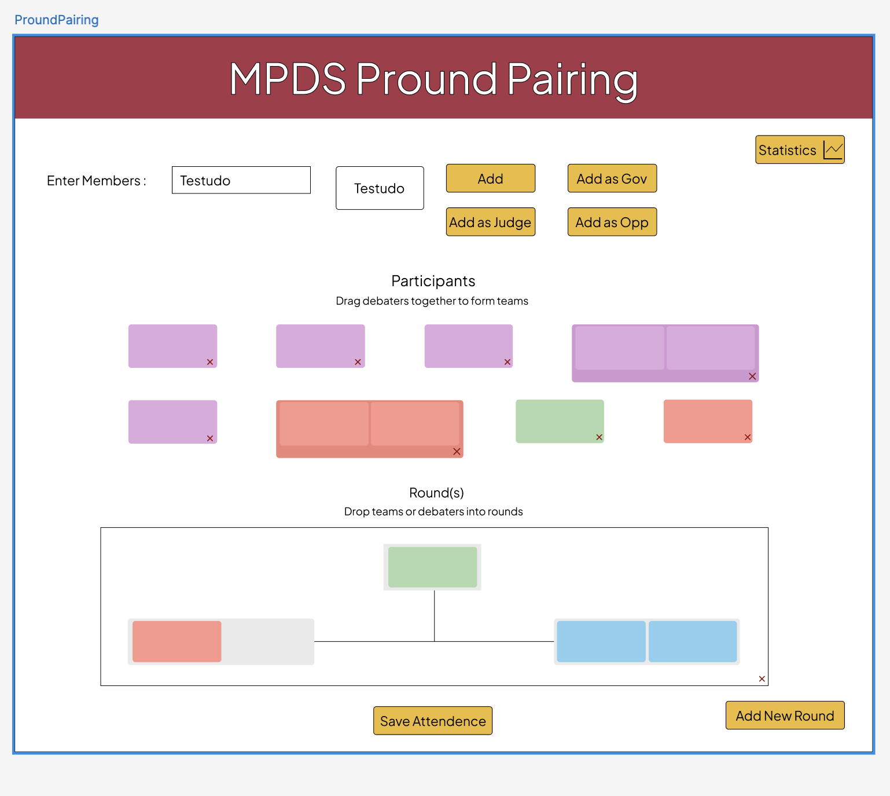

## Overview

A web app for the Maryland Debate Society to manage its roster, build practice rounds with drag-and-drop, and record attendance. A Java/Javalin server provides a small REST API over a SQLite file and serves a plain HTML/CSS/JS frontend. There is no frontend framework and no build step.

## Stack
Layer	Tool / version
Language	Java 17+ (compiles to 17, has run on newer JDKs)
Web framework	Javalin 5.6.3 (on Jetty)
Build	Maven
Database	SQLite via sqlite-jdbc 3.43.2.2
JSON	Jackson 2.15.0 for responses, Gson 2.10.1 for parsing requests
Frontend	Vanilla JS, HTML, CSS
External data	Google Sheets CSV export

## Running it

From the project root (pround-pairing-app/, the folder containing pom.xml):

```bash
mvn clean compile
mvn compile exec:java -Dexec.mainClass="com.pround.pairing.App"
```

Then open http://localhost:7070. A quick sanity check is http://localhost:7070/api/health, which should return {"status":"ok",...}.

roster.db must sit in the project root, because the JDBC URL is the relative path jdbc:sqlite:roster.db.
Java changes need a server restart. Changes to web/ files only need a browser refresh.

## Project layout

```
pround-pairing-app/
  pom.xml
  roster.db
  schema.sql
  src/main/java/com/pround/pairing/
    App.java         # server setup, all routes, request/response classes
    Database.java    # SQLite connection helper (enables foreign keys)
  web/
    index.html       # main pairing page
    statistics.html  # stats page 
    app.js           # shared by both pages
    style.css
```

## Database

```sql
members(id, name, experience_level CHECK IN ('Varsity','Novice','Dino'), years_on_team DEFAULT 1)
sessions(id, session_date 'YYYY-MM-DD', label)
attendance(session_id, member_id)  -- composite primary key
```

schema.sql is the source of truth. Re-running it on an existing database fails because the tables already exist, so use targeted ALTER or rebuild statements instead. SQLite can’t change column defaults or CHECK constraints in place, so that means renaming the table, recreating it, copying the rows over, and dropping the old one.

## API
| Method | Path | Purpose |
|---|---|---|
| `GET` | `/api/health` | Confirms the server and database connection are working. |
| `GET` | `/api/members/search?q=` | Performs a prefix search on member names. Returns a maximum of 5 results as a list of name strings. |
| `GET` | `/api/members` | Returns the full roster, including `id`, `name`, `experience_level`, `start_year`, and `years_on_team`. |
| `POST` | `/api/attendance` | Records an attendance session. Accepts a request body containing `date`, `label`, and `names[]`. |
| `GET` | `/api/tournaments` | Lists all tournaments with date, special description, attendee counts, and team pair counts. |
| `GET` | `/api/tournaments/{id}` | Returns details of a tournament including attendee roster and paired teams. |
| `POST` | `/api/tournaments` | Saves a tournament, special description, attendance, and pairings. |
| `GET` | `/api/statistics/attendance` | Returns dynamic practice attendance statistics calculated from SQLite. |
| `GET` | `/api/statistics/tournament-attendance` | Returns dynamic tournament attendance statistics calculated from SQLite. |
| `GET` | `/api/statistics/pairings` | Returns tournament pairings network data (nodes, links, judging, attendance) with years on team. |

### `POST /api/tournaments`

**Request body:**

```json
{
  "id": 1, // optional, for updating existing
  "name": "Drexel",
  "date": "2026-09-04",
  "description": "Optional note",
  "attendees": ["Jack Beery", "Pranika Singh", "Pranav Sasikumar"],
  "pairs": [
    { "partner1": "Jack Beery", "partner2": "Pranika Singh" }
  ]
}
```

Transactionally records the tournament, updates `tournament_descriptions`, inserts attendees into `tournament_attendance`, and records pairings in `tournament_partners`.


### `POST /api/attendance`

**Request body:**

```json
{
  "date": "YYYY-MM-DD",
  "label": "Session label",
  "names": ["Name 1", "Name 2"]
}
```

**Validation and behavior:**

1. Looks up each submitted name in the `members` table using an exact name match.
2. If any name does not match a member exactly:
   - Rolls back the transaction.
   - Returns **`400 Bad Request`** with a `notFound` list of unmatched names.
   - Writes no data to the database.
3. If all names match:
   - Creates one attendance session and its associated attendance rows.
   - Returns **`201 Created`** with the generated `sessionId`.

**Note:** Attendance submissions are transactional: either the entire session is recorded successfully, or nothing is written.

POST /api/attendance looks up each name in members. If any name doesn’t match exactly, it rolls back, returns 400 with a notFound list, and writes nothing. Otherwise it creates one session plus attendance rows and returns 201 with sessionId.

## Frontend behavior
- Add flow: typing in the input triggers a debounced search. The top match appears in #current-name, and the Add / Gov / Opp / Judge buttons add that person as a draggable chip.
- Duplicate prevention: isAlreadyAdded() checks every chip on the page. The manual buttons alert on a duplicate, and the sheet import skips duplicates and lists them in the summary.
- Rounds: each round has two slots per side plus a judge box. Chips are dragged into landing zones.
- Sheet import: “Populate from Form” fetches a published Google Sheet as CSV. Names are fuzzy-matched to the roster with Levenshtein distance. Near-matches trigger a confirm(), and unmatched or duplicate names are summarized in one alert at the end.
- Save Attendance: asks for confirmation, then posts every chip currently inside a round.

Gotchas
1. SQLite JDBC doesn’t implement getGeneratedKeys(). Use SELECT last_insert_rowid() after an insert.
2. Jackson only serializes public fields. Any class passed to ctx.json(...) needs public fields. Request classes parsed with Gson can be package-private.
3. app.js is shared across pages, so every element lookup must be null-guarded. An unguarded getElementById(...).addEventListener(...) crashes on any page missing that element, and it silently kills all code below it in the file. This caused several bugs, including the broken back button on the stats page. Guard anything new, including .closest() calls and the hoverConfigs loop.
4. Static files are served from the filesystem (Location.EXTERNAL, directory web), relative to the directory the server is launched from.

## Known limitations and decisions to revisit
- Names are the identifiers. Two members with the same name will collide, and typos fail the save. Moving to member IDs (for example data-id on chips) is the proper fix.
- Saving twice creates two sessions for the same day. There is no upsert.
- Roles and round layouts aren’t persisted. Only attendance is stored.
- Sheet parsing is hardcoded. The sheet ID and GID are in app.js, the name is read from column index 1, and column 3 == "Debate" decides debater versus judge. The first row is dropped as a header. The sheet must be shared as “anyone with the link can view.” The CSV parser splits on newlines, so it breaks if a cell contains one.
- The fuzzy-match threshold is length / 2. That is quite loose and can match the wrong person for long names. length / 4 is stricter. This was changed deliberately at one point, so decide which you want.
- No authentication, and it only runs locally. Anyone who can reach port 7070 can read and write data.


## Initial Wireframe designed using Figma
